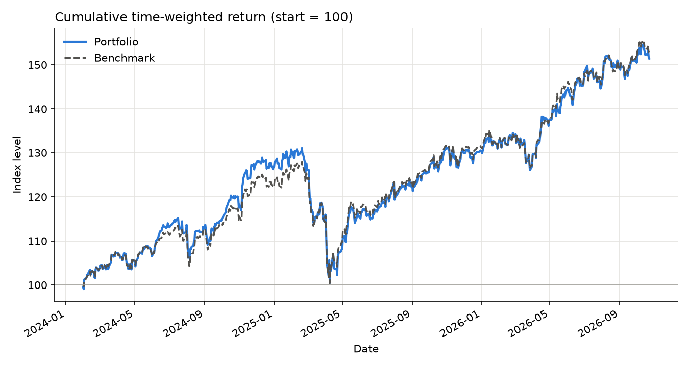
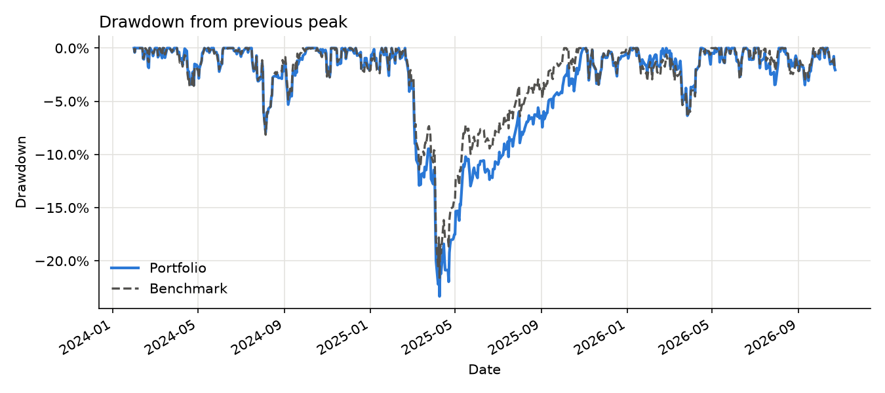
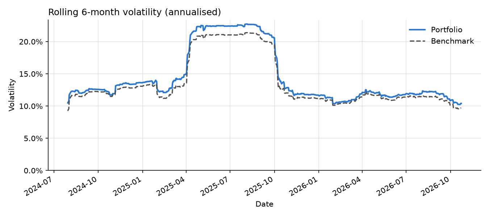
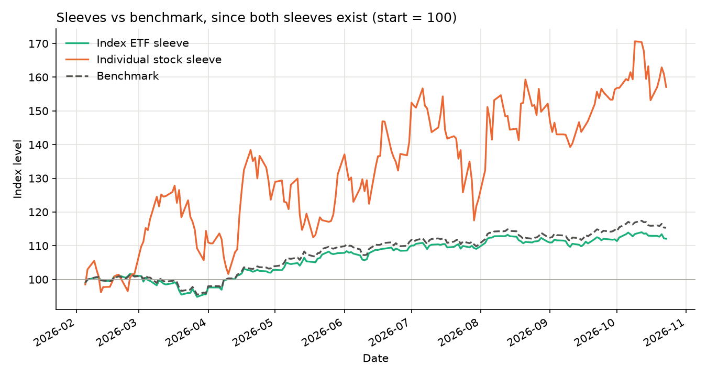

# Portfolio risk analysis

Risk and performance analysis of my self-managed investment portfolio against a
global equity benchmark: volatility, maximum drawdown, Sharpe ratio, beta, alpha,
tracking error, and how much of the gap to the benchmark came from the
**Index ETF sleeve**, the **Individual stock sleeve**, cash and costs.

The portfolio is held at two brokers (Interactive Brokers and Revolut). The
period is January 2024 to October 2026, in EUR.

> All returns are **unrealised, pre-tax and based on market values**.


---

## Privacy

The repository contains no account numbers, money amounts, balances, deposit
dates or names of the instruments I hold. Results are published only as
percentages, rebased indices (start = 100) and summary metrics.

- Real broker exports live in `data_private/`, which is git-ignored.
- `check_public_outputs.py` scans every other file for account-number patterns,
  currency amounts and private terms. It reads the tickers, ISINs and account ids
  straight from the private files, so the list of what to hide is never committed.
  It runs automatically before each commit (`git config core.hooksPath hooks`).
- `data_sample/` holds **synthetic** data in the same format as the real exports,
  so the project runs end to end for anyone.

## How to run

```bash
python -m venv .venv && source .venv/bin/activate
pip install -r requirements.txt

pytest                                   # unit tests
python -m src.pipeline                   # sample data -> output_sample/
python -m src.pipeline --private         # real data   -> data_private/output/ (local only)
python check_public_outputs.py           # privacy check before committing
python validate_private.py               # local cross-check against broker/app figures
```

`notebooks/analysis.ipynb` runs the same pipeline on the sample data; set
`USE_PRIVATE_DATA = True` to use the real data locally.

To use your own data, put the exports in `data_private/` together with an
`instruments.csv` (`broker_symbol, yahoo_symbol, currency, sleeve`), in the same
layout as `data_sample/instruments.csv`.

## Data and sources

| What | Source | Exact series |
|---|---|---|
| Transactions | Interactive Brokers Activity Statement (CSV); Revolut trading-account statement (CSV) | parsed by `src/parsers.py` |
| Prices | Yahoo Finance via `yfinance` | daily `Close` (split-adjusted, not dividend-adjusted, because dividends are already booked as cash) |
| Benchmark | iShares Core MSCI World UCITS ETF (Acc), Euronext Amsterdam, in EUR | Yahoo `IWDA.AS`, `Adj Close` (total return) |
| FX | ECB euro reference rates | `EXR.D.USD.EUR.SP00.A` (US dollars per euro) |
| Risk-free rate | Euro short-term rate (€STR), ECB | `EST.B.EU000A2X2A25.WT` (percent per year, ACT/360) |

Downloads are cached locally, so results are reproducible and the analysis runs
offline after the first run.

## Method

**1. Normalise transactions.** Both broker formats are mapped to one table:
date, account, instrument, type (buy, sell, dividend, interest, fee, tax,
deposit, withdrawal), quantity, price, cash amount, commission, currency.

**2. Rebuild daily holdings and cash.** Positions and cash balances are cumulative
sums of the transactions on a Monday–Friday calendar. A weekend transaction moves
to the next Monday. Positions are valued at the market close. USD prices and cash
are converted to EUR with the ECB rate of the day. On exchange holidays the last
price is carried forward.

**3. Time-weighted return (TWR).** The TWR removes the effect of *when* money was
deposited, so it can be compared with a benchmark. Money arriving on day *t* is
treated as available from the start of the day:

$$r_t = \frac{V_t + I_t}{V_{t-1} + F_t} - 1, \qquad \text{TWR} = \prod_t (1 + r_t) - 1$$

The terms in this formula:

- *V* is the market value at the close.
- *F* is the net money added that day.
  - For the whole portfolio, *F* is deposits minus withdrawals.
  - For a sleeve, *F* is purchases (including commissions) minus sale proceeds.
- *I* is income paid out of the sleeve, i.e. dividends. For the whole portfolio
  *I* is zero, because dividends stay in the account as cash.

The same formula gives the return of the whole portfolio and of each sleeve.

**4. Metrics.** These use daily returns and *N* = 261 weekdays per year. Holidays
stay in the calendar with a zero return, so annualising by 261 keeps the yearly
variance correct.

| Metric | Formula | Plain English |
|---|---|---|
| Total return | $\prod (1+r_t) - 1$ | growth of 1 euro over the period |
| Annualised return | $(1+\text{TR})^{N/n} - 1$ | yearly growth rate; not shown for periods under one year |
| Volatility | $\sigma(r_t)\sqrt{N}$ | typical size of yearly swings |
| Max drawdown | $\min_t \left( W_t / \max_{s \le t} W_s - 1 \right)$ | worst fall from a previous high, with peak, trough and recovery dates |
| Sharpe ratio | $\dfrac{\overline{r - r_f}\cdot N}{\sigma(r - r_f)\sqrt{N}}$ | return above cash per unit of risk |
| Beta, alpha | OLS: $r - r_f = \alpha + \beta (r_b - r_f) + \varepsilon$; $\beta = \text{cov}/\text{var}$; alpha annualised as $\alpha N$ | sensitivity to the market, and return not explained by it |
| Tracking error | $\sigma(r - r_b)\sqrt{N}$ | how differently from the benchmark it moves |

Beta is also estimated on Friday-to-Friday weekly returns. US stocks close
several hours after the European-listed benchmark, so part of a day's market move
appears in their return only the next day. That biases a daily beta downwards.

The risk-free return per weekday is the growth of an index that accrues €STR on
every calendar day ($1 + \text{€STR}/360$ per day). Monday's risk-free return
therefore includes the weekend.

**5. Attribution of the gap to the benchmark.** Each day, the portfolio return
is the sum of the contributions $c_k$ of its parts, and the start-of-day weights
$w_k$ of the ETF sleeve, the stock sleeve and cash sum to one. Therefore, exactly:

$$r_t - r_{b,t} = \sum_k \left( c_{k,t} - w_{k,t}\, r_{b,t} \right) + c_{\text{costs},t}$$

- A sleeve's line is what it earned before commissions minus what the same money
  would have earned in the benchmark.
- The cash line is interest and FX on cash, minus the benchmark return that idle
  cash missed.
- Costs are commissions, fees and tax not tied to a holding.

The daily terms are summed over the period. The "compounding effect" line is the
difference between that sum and the actual gap between the cumulative returns.

## What I found

Period: January 2024 to October 2026 (about 2.7 years). Benchmark: MSCI
World UCITS ETF in EUR. The "Benchmark" row covers the same period.

| | Portfolio | Benchmark | Index ETF sleeve |
|---|---|---|---|
| Total return | 51.4% | 52.8% | 48.4% |
| Annualised return | 16.4% | 16.8% | 15.5% |
| Volatility | 14.3% | 13.5% | 14.4% |
| Max drawdown | −23.3% | −21.6% | −23.7% |
| Sharpe ratio | 0.95 | 1.02 | 0.89 |
| Beta (daily / weekly) | 1.04 / 1.03 | 1.00 | 1.05 / 1.02 |
| Alpha (annualised) | −0.7% | – | −1.6% |
| Tracking error | 3.3% | – | 2.6% |

**Overall, the portfolio slightly lagged the benchmark.**

- It returned 1.4 percentage points (pp) less over the period, with slightly
  higher volatility and a deeper drawdown.
- Its Sharpe ratio was lower: 0.95 against 1.02.
- The worst drawdown was the same market sell-off for both. The peak was on
  19 February 2025 and the trough on 9 April 2025. The portfolio took about a
  month longer than the benchmark to get back to its previous high.







The portfolio's 6-month volatility stayed slightly above the benchmark's
throughout, and both peaked in the six months after the April 2025 sell-off.

**Gap to the benchmark, by source (percentage points):**

| Index ETF sleeve | Individual stock sleeve | Cash | Costs | Compounding | **Total** |
|---|---|---|---|---|---|
| −2.2 | +1.7 | +0.0 | −0.1 | −0.8 | **−1.4** |

**The Index ETF sleeve explains the shortfall.** Over the period it returned
4.4 pp less than the benchmark (48.4% against 52.8%) and had a deeper drawdown.
It holds other index ETFs besides MSCI World, so it does not track the benchmark
exactly.

**The individual stocks added value, but the evidence is weak.**

- The stock sleeve existed only from February 2026, about 8.5 months.
- Over that time it returned 57.1%, against 15.3% for the benchmark.
- Its volatility was 60%, compared with 11% for the benchmark.
- It was a small part of the portfolio, about 7% on average. So it raised the
  overall return by roughly 1.7 pp; it did not dominate it.
- That result comes from a handful of stocks over less than a year. It is not
  evidence of stock-picking skill. The regression makes the same point:
  - The R² is 0.02 on daily data and 0.19 on weekly data, so the benchmark
    explains almost none of the sleeve's movement.
  - The "alpha" is therefore mostly noise.
  - The weekly beta of about 3 shows how much more volatile the sleeve was than
    the market.



**Costs were small**, about 0.1 pp over the whole period. Cash had no material
effect.

## Validation

- **Unit tests (`pytest`)** check, on small hand-computed examples:
  - the time-weighted return with deposits and withdrawals
  - drawdown and its dates
  - Sharpe ratio
  - beta and alpha
  - the €STR conversion
  - the attribution adding up exactly
  - the parsers and holdings
- **Broker cross-check** (`validate_private.py`, local only):
  - I recomputed the Interactive Brokers account on its own for the statement
    period and compared it with the time-weighted return printed on the IBKR
    statement.
  - The rebuilt profit and loss matches the statement to within 0.01% of the
    account value. The small difference comes from closing prices, Yahoo against
    IBKR.
  - The time-weighted return differs by 0.19 pp. For most of that period the
    account held only a small cash balance, mostly in US dollars, so its return
    was essentially the USD/EUR rate. Small differences between the ECB fixing
    (14:15 CET) and IBKR's own end-of-day FX rates are magnified there.
- **Other app:** the same script compares the combined return with the figure
  from another tracking app, entered privately. The script prints only the
  differences.

## Estimates and data gaps

Every estimate is flagged in the pipeline's "data quality notes":

- **Revolut commissions.** Revolut does not report commissions separately. They
  are estimated as the amount charged minus quantity × price, when that is
  positive.
- **IBKR opening cash.** The IBKR statement starts in January 2026. Cash held
  before then (a negligible balance, no positions) is treated as a deposit on
  the first day of the statement.
- **Missing prices.** If no market price exists for a day on which a position is
  held, the last trade price is used and flagged. This did not happen in the real
  data.
- **Stock splits.** A split while a position is held is flagged; quantities are
  not adjusted automatically. No split affected the real data.

## Limitations

- **Short history.** About 2.7 years, roughly one and a bit market cycles,
  including one sharp sell-off. The individual-stock sleeve has less than a year
  of history. None of the risk estimates are statistically precise.
- **The benchmark is an ETF proxy** for MSCI World. Its returns are after the
  fund's fees and tracking difference, not the index itself.
- **No tax modelling.** Returns are pre-tax. Withholding tax is included only
  where the broker deducted it.
- **FX.** USD values use the ECB reference rate, not the rates the brokers
  actually applied.
- **Timing conventions.** Flows are assumed to arrive at the start of the day,
  and daily returns mix European and US closing times. The weekly beta is given
  as a check on the second point.
- **Prices from Yahoo Finance** can differ slightly from broker closing prices.

## Project structure

```
src/parsers.py      broker CSVs -> one normalised transaction table
src/holdings.py     daily positions, cash, flows and sleeve values (EUR)
src/prices.py       yfinance prices, ECB FX and €STR, with local cache
src/returns.py      time-weighted returns and daily profit decomposition
src/metrics.py      risk metrics and attribution (formulas in the docstrings)
src/plots.py        charts (rebased indices and percentages only)
src/pipeline.py     runs everything; writes charts and results.md
tests/              pytest unit tests
notebooks/          analysis notebook (sample data by default)
data_sample/        synthetic data + generator script
output_sample/      results from the synthetic data
figures/            charts from the real data, used in this README
                    (copied from data_private/output/ after review)
check_public_outputs.py   privacy scan (run before every commit)
validate_private.py       local-only cross-checks
```

## Development and verification

This project was developed with assistance from an AI coding tool. I designed the analysis scope, reviewed the financial methodology and implementation, and verified the key calculations through hand-checked unit tests and reconciliation against independently reported broker figures. I remain responsible for the analytical choices, results, and documentation.
